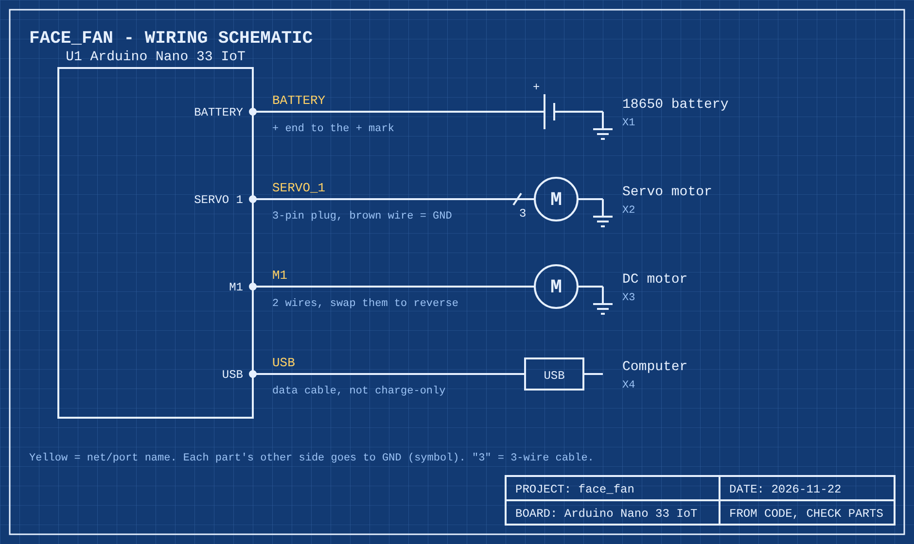

# arduino-mcp

**Let Claude write, compile, upload, test and debug Arduino code on your real board.**

An [MCP](https://modelcontextprotocol.io) server that wraps the official
[`arduino-cli`](https://arduino.github.io/arduino-cli/). Plug in your Arduino,
add this server to Claude Code (or Claude Desktop / VS Code), and ask:

> Write a sketch that blinks the LED and prints "TEST ok" every second, then
> test it on my board.

Claude will compile it, read the errors, fix them, upload it, read the Serial
output and tell you PASS or FAIL, looping until it works.

It runs on **your own computer**, because it needs the USB port.

---

## What it does

**The test and debug loop**

1. **`check_sketch`** compiles the code with no board needed. It returns each
   error with the file, the line, the code on that line and a plain-English
   hint. It also runs extra checks the compiler doesn't do: a missing
   `Serial.begin`, long blocking `delay()`s, `while(!Serial)` freezing on
   battery, and a missing `controller.begin()` / `controller.ping()` for the
   Arduino Motor Carrier.
2. **`library`** fact-checks a library. It reads the real function names
   and parameters from the installed library's `.h` files, so Claude doesn't
   invent functions that don't exist.
3. **`test_on_board`** does compile, upload, open Serial, send test lines,
   read the output and answer **PASS** / **FAIL**, all in one call. You give it what
   must appear (`expect`), what means failure (`fail_on`) and what to send (`send`).

You can paste code straight in (the `code` input), or point at a `.ino` file
or sketch folder. Sketches whose folder name doesn't match the `.ino` name
work too. Re-compiles are faster because each sketch keeps its build folder.

**All tools**

| Tool | What it does |
|---|---|
| `check_sketch` | Compile + clear errors + extra checks. No board needed. `guide=True` also opens a parts page (see below). |
| `test_on_board` | Write, compile, upload, Serial test, PASS/FAIL in one call. Board and port auto-detected. |
| `serial` | Send a line and/or read Serial output. |
| `library` | Real functions of an installed library, list installed libraries, or search the Library Manager. |
| `install` | Install a board core (`arduino:samd`) or a library (`Servo`). |
| `boards` | arduino-cli status and connected boards, or search a board's FQBN. |
| `ide` | Arduino IDE window (Windows): `open`, `type` the code in, press `verify` / `upload`. |
| `wiring_steps` | Opens a 3D step-by-step breadboard wiring page in your browser (see below). |

The plugin version also includes the `arduino-dev` skill, which tells Claude to work in this order.

The default board is the **Arduino Nano 33 IoT** (`arduino:samd:nano_33_iot`).
For any other board, just tell Claude which one ("use an Uno"), or change the
default (see [Settings](#settings)).

---

## It fills in the details itself

You don't need to tell Claude the board or port. The tools:
- **detect the plugged-in board and port** (`arduino-cli board list`) and use
  them. If there are several boards, or none, Claude asks you one short
  question instead of failing.
- **remember the board and port** in the sketch's `sketch.yaml` for their own
  compile/upload tools. (Arduino IDE ignores that file: pick the board once in
  the IDE's board dropdown and it remembers it.)
- **install a missing board package** by themselves, then retry the compile.
- **name the missing library**, and Claude asks you if there are several candidates.
- **tell you what to close** when the port is busy (Serial Monitor, a Python script...).

## Parts page: what you need, how to wire it, where to buy it

Ask "show me what I need for this sketch". `check_sketch` with `guide=True`
writes `<sketch>_parts.html` next to the sketch and opens it in your browser:
- a **blueprint-style wiring drawing**: the board seen from above with its real
  header pins (Nano-size boards), the Motor Carrier's SERVO 1-4 / M1-M4 / battery
  ports, and each wire running from the exact pin or port to the part (servo
  signal/+5V/GND colours, motor + and -). Carrier port positions are approximate
  (Arduino doesn't publish them), and other boards are drawn as a simple pin list.
  It is also saved as `<sketch>_schematic.svg`,
- a **parts checklist**, a **tools you need** checklist (screwdriver, wire
  stripper, breadboard, jumper wires, resistors, charger, multimeter: only the
  ones the sketch needs) and a **software checklist** (board package, libraries),
- **where to buy** each part: search links for Amazon (pick your country),
  AliExpress, eBay, the Arduino Store, price comparison and shops near you,
- **similar projects** (Arduino Project Hub, Hackster, Instructables) and
  **CAD / 3D-print models** (Printables, Thingiverse, GrabCAD).



It is worked out from the code, so it knows the pins and ports, not the exact
part you plugged in. Name a part with a comment like `// PART: SG90 servo -> SERVO1`.
The shop links are searches, not checked prices or stock.

## 3D wiring, one step at a time

Ask "show me how to wire it step by step". `wiring_steps` writes
`<title>_wiring_steps.html` and opens it in your browser:
- a **tilted 3D breadboard** with the board, chips, power module, servo and motor,
- **one step per screen**: the new wires are bright, earlier wires are faded,
  parts appear when they are placed, and the board pins you use light up yellow,
- **Back / Next** buttons (or the arrow keys), **Show all** for the finished
  build, and a **tilt** slider,
- **no text on the wires**, so nothing hides the hole a wire goes into. The
  wire colour shows which wire it is, and the step text at the top says where it goes.

Claude describes the build as parts plus steps. Wire ends are a breadboard hole
(`j10`), a rail (`+top`, `-bot`, `-bot:13`), a board pin (`pin:10`, `pin:GND`),
a part terminal (`servo.SIG`, `motor.1`) or a chip pin (`U1.3`, which picks a
free hole in that pin's column). Boards: Mega and Uno (others are drawn as an Uno-size board).
Example: [`examples/face_fan_wiring/spec.json`](examples/face_fan_wiring/spec.json).


## See what Claude is doing

- **Your Arduino IDE shows the code.** The first time Claude checks or tests
  a sketch, it opens it in Arduino IDE. Claude keeps writing to that same
  file, so the IDE window shows each change.
- **The board is set for the plugin's own tools.** The server saves the board
  (and, after the first upload, the port) in the sketch's `sketch.yaml` with
  `arduino-cli board attach`, so its compile/upload/test tools don't need you
  to pick anything. **Arduino IDE 2.3 does not read that file** (tested), so
  for the IDE's own Verify/Upload buttons pick the board once in the IDE's
  board dropdown; the IDE remembers it for that sketch.
- **Watch the code being written in the IDE (Windows).** `ide` with `type`
  brings the sketch's Arduino IDE window to the front, clicks once in its
  editor, clears it and puts the code in line by line (pasting each line, so
  the IDE's auto-indent and auto-closing brackets can't mangle it). It sends
  keys only while that IDE window is in front and stops if you click away. Then
  it saves (Ctrl+S) and checks the saved file matches the code. It borrows the
  clipboard while typing and puts your clipboard text back afterwards.
- **Verify / Upload in the IDE, if you want to watch them.** `ide` with `verify`/`upload`
  brings the Arduino IDE window to the front and presses Ctrl+R (Verify) or
  Ctrl+U (Upload), like you would. It only presses keys if the IDE window is
  really in front. It can't read the IDE's result, so Claude confirms with a
  normal check afterwards.
- **Every reply says what ran:** a short `[did: ...]` line lists each
  arduino-cli command, port and time. The full log is in
  `Documents/arduino-mcp-sketches/arduino-mcp.log`.

**Why not type the code into the IDE with the mouse and keyboard?** Claude
can do that with computer use (screenshots plus clicks), like the "second
cursor" MCPs for CAD apps. But each step needs a screenshot, which costs
roughly 1,000 to 1,500 tokens and a few seconds. A compile, fix and upload
loop would take minutes and use tens of thousands of tokens. Arduino IDE 2
has no official API for other programs to drive it. So this server uses a
hybrid: the real work goes through arduino-cli (the same engine and the same
installed boards and libraries as the IDE), and the IDE is used to *show*
you the code and, when you ask, run Verify/Upload where you can see it.

**Token use:** 7 tools whose definitions total about 690 tokens (down from
about 1,550 in v0.4), plus a short skill. Claude Code usually loads MCP tool
details only when they're needed, so the fixed cost per conversation is
mostly the tool names. Replies are compact: errors only, repeated Serial lines
collapsed (`READY (x12)`), long paths shortened.

## Install as a Claude plugin (easiest)

You still need **Python 3.10+** and **arduino-cli** on your computer (step 1
below). The plugin installs its two Python packages by itself on first start.

**Claude Code:**
```
/plugin marketplace add PhamAnhHoangg/Arduino-IDE-MCP
/plugin install arduino@arduino-ide-mcp
```
Restart Claude Code, then check `/mcp`. You should see `plugin:arduino:arduino`
connected. The plugin also adds an `arduino-dev` skill that teaches Claude the
check, fix, test loop.

**Claude desktop app:** download
[`dist/arduino.plugin`](dist/arduino.plugin) from this repo and upload it in
the app's plugin settings (or drag it into a chat).

On macOS/Linux, if `python` isn't found, edit `.mcp.json` to use `python3`.

## Manual install (3 steps)

You need **Python 3.10+** and **arduino-cli**.

### 1. Install arduino-cli

| System | Command |
|---|---|
| Windows | `winget install ArduinoSA.CLI` |
| macOS | `brew install arduino-cli` |
| Linux | `curl -fsSL https://raw.githubusercontent.com/arduino/arduino-cli/master/install.sh \| sh` (puts it in `./bin`; move it onto your PATH) |

Already have **Arduino IDE 2** on Windows or macOS? You can skip this step.
The server looks for the copy of arduino-cli that ships inside the IDE.

No Python yet? Get it from [python.org](https://www.python.org/downloads/).
On Windows, tick **"Add python.exe to PATH"** in the installer.

### 2. Download this repo and install the Python packages

Click **Code > Download ZIP** on GitHub and unzip it (or `git clone` it), then
in a terminal inside the folder:

```
python -m pip install -r requirements.txt
```
(On macOS/Linux use `python3` if `python` isn't found.)

### 3. Add it to Claude

**Claude Code** (terminal, and the Claude Code extension for VS Code / JetBrains):

```
# Windows
claude mcp add arduino --scope user -- python "C:\path\to\arduino-mcp\arduino_mcp.py"

# macOS / Linux
claude mcp add arduino --scope user -- python3 /path/to/arduino-mcp/arduino_mcp.py
```
Restart `claude` and type `/mcp`. You should see **arduino** connected.

<details>
<summary><b>Claude Desktop</b></summary>

Settings > Developer > Edit Config, then add:
```json
{
  "mcpServers": {
    "arduino": {
      "command": "python",
      "args": ["C:\\path\\to\\arduino-mcp\\arduino_mcp.py"]
    }
  }
}
```
On Windows, write paths with double backslashes. On macOS/Linux use `python3`
and a normal path. Restart the app.
</details>

<details>
<summary><b>VS Code (Copilot agent mode)</b></summary>

Copy `vscode-mcp.example.json` to `.vscode/mcp.json` in your project, fix the
path inside, and click **Start** above the server entry.
</details>

Finally, install your board's core once. You can just ask Claude
"install the core for my board", or run it yourself:
```
arduino-cli core update-index
arduino-cli core install arduino:avr      # Uno, Mega, classic Nano
arduino-cli core install arduino:samd     # Nano 33 IoT, MKR boards
```

---

## Example prompts

- "List my connected Arduino boards."
- "Check `blink/blink.ino` and fix any errors."
- "Write a sketch that reads A0 and prints the value. Test it on COM5, expecting a number."
- "Run `examples/serial_selftest` on my board, send `ping`, expect `READY` and `pong`."
- "What functions does the ArduinoMotorCarrier library have for servos?"
- "Read the serial output for 10 seconds."

**Tip for testable sketches:** have the sketch print clear markers like
`READY` or `TEST ok`, and print them repeatedly or in reply to a command.
Output in the first second after reset can be missed while USB reconnects.
See [`examples/serial_selftest`](examples/serial_selftest/serial_selftest.ino).

---

## Settings

Optional environment variables. Add them with `-e` in `claude mcp add`, e.g.
`claude mcp add arduino --scope user -e ARDUINO_FQBN=arduino:avr:uno -- python ...`

| Variable | Meaning | Default |
|---|---|---|
| `ARDUINO_CLI` | Full path to `arduino-cli` if it isn't found automatically | PATH, `Program Files\Arduino CLI`, WinGet, Arduino IDE 2 |
| `ARDUINO_FQBN` | Default board | `arduino:samd:nano_33_iot` |

---

## Troubleshooting

- **"arduino-cli was not found"**: set `ARDUINO_CLI` to its full path
  (`where arduino-cli` on Windows, `which arduino-cli` on macOS/Linux).
- **Upload: "access denied" / "port busy"**: only one program can use a serial
  port. Close the Arduino IDE Serial Monitor and any script using the port.
- **No board found**: try another USB cable, because some only charge.
- **Linux: permission denied on `/dev/ttyACM0`**: run
  `sudo usermod -aG dialout $USER`, then log out and back in.
- **Native-USB boards (Nano 33 IoT, MKR, Leonardo) won't upload**: double-tap
  reset (the LED pulses) and try again. The port name can change after this.
- **First compile is slow**: that's normal. Later ones are faster.

---

## Limits

- `test_on_board` only sees what the board prints over Serial. It can't see a
  motor turn or an LED light. Make the sketch print what it did (sensor values,
  encoder counts), or check the hardware yourself.
- Claude can make mistakes. Read the code before running it on hardware that
  can move, heat up, or draw a lot of current.

## Status: what is tested

This is an early version.

**Tested** (Linux, Python `mcp` 1.x, through a real MCP client):
- The server starts and all 8 tools load.
- The `wiring_steps` page, rendered in Chromium (steps, Show all, tilt), with the face fan example.
- The plugin passes `claude plugin validate`, installs in Claude Code from the
  marketplace, shows as connected in `claude mcp list`, and auto-installs its
  Python packages into a fresh Python environment.
- Compile-error parsing, hints and extra checks, using real `g++` compiler errors.
- `library` against the real ArduinoMotorCarrier library source.
- `test_on_board` and `serial` against a **simulated** serial board
  (PASS, FAIL, compile failure, send and reply).

**Not tested yet:**
- Real compiles with the Arduino toolchain, and real uploads to a board.
- Windows and macOS (including the plugin in the Claude desktop app).
- Finding the arduino-cli bundled in Arduino IDE 2.
- `ide open` and `ide verify/upload` on a real Windows PC (Linux test machine has no IDE),
  and whether Arduino IDE always reloads a file changed by Claude.

If you try it, please open an issue with what worked or broke.

## Credits

Built by PhamAnhHoangg with help from Claude, an AI assistant tool by Anthropic.

## License

[MIT](LICENSE)
