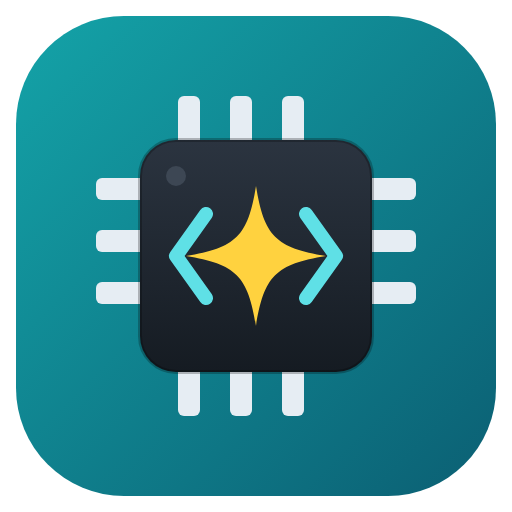
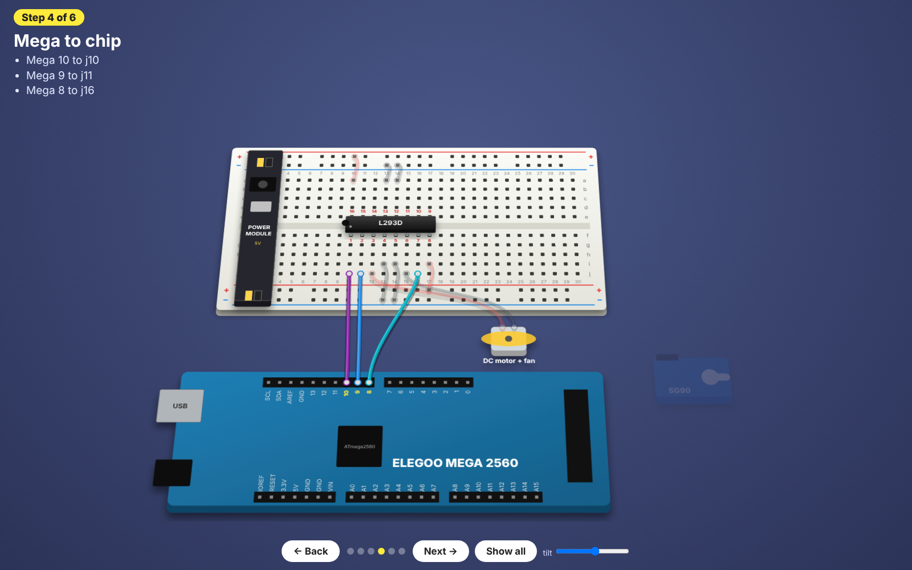

<div align="center">



# Arduino IDE MCP

**Let Claude write, compile, upload, test and debug Arduino code on your real board.**

[](https://github.com/PhamAnhHoangg/Arduino-IDE-MCP/actions/workflows/ci.yml)
[](https://github.com/PhamAnhHoangg/Arduino-IDE-MCP/releases)
[](LICENSE)

[Quick start](#quick-start) ·
[Proof](#proof-a-real-project) ·
[Features](#features) ·
[Tools](#tools) ·
[Install](#install) ·
[Troubleshooting](#troubleshooting) ·
[Development](#development)

</div>

An [MCP](https://modelcontextprotocol.io) server and Claude plugin built on the
official [`arduino-cli`](https://arduino.github.io/arduino-cli/). Plug in your
Arduino and ask:

> Write a sketch that blinks the LED and prints "TEST ok" every second, then
> test it on my board.

Claude compiles it, reads the errors, fixes them, uploads it, reads the Serial
output and tells you **PASS** or **FAIL**, looping until it works. It runs on
**your own computer**, because it needs the USB port.

## Quick start

You need **Python 3.10+** and **arduino-cli** ([how to install](#1-install-arduino-cli)).
The plugin installs its Python packages by itself on first start.

**Claude Code**

```
/plugin marketplace add PhamAnhHoangg/Arduino-IDE-MCP
/plugin install arduino@arduino-ide-mcp
```

Restart Claude Code and check `/mcp`: `plugin:arduino:arduino` should be connected.

**Claude desktop app:** download `arduino.plugin` from the
[latest Release](https://github.com/PhamAnhHoangg/Arduino-IDE-MCP/releases/latest)
(or [`dist/arduino.plugin`](dist/arduino.plugin)) and upload it in the app's
plugin settings, or drag it into a chat.

On macOS/Linux, if `python` isn't found, edit `.mcp.json` to use `python3`.

## Proof: a real project

**[ELEGOO-2560-fan-OpenCV](https://github.com/PhamAnhHoangg/ELEGOO-2560-fan-OpenCV)**
is a face-following fan on an ELEGOO Mega 2560 (OpenCV webcam, SG90 servo,
L293D). With this plugin, Claude compiled and checked the sketch on the real
toolchain, opened it in Arduino IDE, found the COM port and generated the 3D
wiring steps used to build it. It works on real hardware.

| Camera finds the face | Servo + fan on the real board |
|:---:|:---:|
| [](https://github.com/PhamAnhHoangg/ELEGOO-2560-fan-OpenCV) | [](https://github.com/PhamAnhHoangg/ELEGOO-2560-fan-OpenCV) |

---

## Features

### The test and debug loop

1. **`check_sketch`** compiles with no board needed and returns each error with
   the file, line, code and a plain-English hint. It also catches what the
   compiler doesn't: a missing `Serial.begin`, long blocking `delay()`s,
   `while(!Serial)` freezing on battery, and a missing `controller.begin()` /
   `controller.ping()` for the Arduino Motor Carrier.
2. **`library`** reads the real function names and parameters from the
   installed library's `.h` files, so Claude doesn't invent functions.
3. **`test_on_board`** compiles, uploads, opens Serial, sends test lines, reads
   the output and answers **PASS** / **FAIL** in one call (`expect`,
   `fail_on`, `send`).

Paste code straight in (`code`) or point at a `.ino` file or sketch folder.
Re-compiles are faster because each sketch keeps its build folder. The plugin
also adds the `arduino-dev` skill, which teaches Claude this check, fix, test loop.

### 3D wiring, one step at a time

When a new sketch with wired parts first compiles, Claude opens a step-by-step
3D breadboard page **by itself** (or ask "show me how to wire it step by step"):

- a **tilted 3D breadboard** with the board, chips, power module, servo and motor,
- **one step per screen**: new wires bright, earlier wires faded, used board pins light up yellow,
- **Back / Next** (or arrow keys), **Show all**, and a **tilt** slider,
- **no text on the wires**, so nothing hides the hole a wire goes into.



<details>
<summary><b>How Claude describes a build</b></summary>

Parts plus steps. Wire ends are a breadboard hole (`j10`), a rail (`+top`,
`-bot`, `-bot:13`), a board pin (`pin:10`, `pin:GND`), a part terminal
(`servo.SIG`, `motor.1`), a chip pin (`U1.3`, which picks a free hole in that
pin's column), the board's USB port (`usb`, to a `laptop` part's `pc.USB`) or a
power module's battery socket (`power.jack+`, `power.jack-`). Boards: Mega and
Uno (others are drawn as an Uno-size board). The page is saved as
`<title>_wiring_steps.html`. Example:
[`examples/face_fan_wiring/spec.json`](examples/face_fan_wiring/spec.json).
</details>

### Parts page: what you need and where to buy it

Ask "show me what I need for this sketch". `check_sketch` with `guide=True`
writes `<sketch>_parts.html` and opens it: a blueprint-style wiring drawing
(also saved as `<sketch>_schematic.svg`), parts, tools and software
checklists, shop search links, similar projects and CAD / 3D-print models.

<details>
<summary><b>More about the parts page</b></summary>

- The **wiring drawing** shows the board from above with its real header pins
  (Nano-size boards), the Motor Carrier's SERVO 1-4 / M1-M4 / battery ports,
  and each wire from the exact pin or port to the part. Carrier port positions
  are approximate (Arduino doesn't publish them); other boards are drawn as a
  simple pin list.
- **Checklists:** parts, tools (only the ones the sketch needs) and software
  (board package, libraries).
- **Where to buy:** search links for Amazon (pick your country), AliExpress,
  eBay, the Arduino Store, price comparison and shops near you. They are
  searches, not checked prices or stock.
- **Similar projects** (Arduino Project Hub, Hackster, Instructables) and
  **CAD / 3D-print models** (Printables, Thingiverse, GrabCAD).
- It is worked out from the code, so it knows the pins and ports, not the exact
  part you plugged in. Name a part with a comment like `// PART: SG90 servo -> SERVO1`.


</details>

### It fills in the details itself

You don't need to tell Claude the board or port. The tools detect the plugged-in
board and port, remember them in the sketch's `sketch.yaml`, install a missing
board package, name a missing library, and tell you what to close when the port
is busy. With several boards (or none), Claude asks one short question instead
of failing.

The default board is the **Arduino Nano 33 IoT** (`arduino:samd:nano_33_iot`).
For any other board, tell Claude ("use an Uno") or change the default in
[Settings](#settings).

### See what Claude is doing

- **Arduino IDE shows the code.** The first check opens the sketch in Arduino
  IDE, and Claude keeps writing to that file, so you see each change.
- **Every reply says what ran:** a short `[did: ...]` line lists each
  arduino-cli command, port and time. The full log is in
  `Documents/arduino-mcp-sketches/arduino-mcp.log`.

<details>
<summary><b>Typing into the IDE, Verify/Upload buttons, and why not computer use</b></summary>

- **Board setting.** The server saves the board (and, after the first upload,
  the port) in `sketch.yaml` with `arduino-cli board attach` for its own tools.
  **Arduino IDE 2.3 does not read that file** (tested), so for the IDE's own
  buttons pick the board once in the IDE's dropdown; it remembers it.
- **`ide type` (Windows)** brings the sketch's IDE window to the front, clicks
  once in the editor, clears it and pastes the code line by line (so auto-indent
  and auto-closing brackets can't mangle it). It sends keys only while that
  window is in front and stops if you click away, then saves (Ctrl+S) and
  checks the saved file matches. It borrows the clipboard and puts your text back.
- **`ide verify` / `ide upload`** press Ctrl+R / Ctrl+U in the IDE window, only
  if it is really in front. They can't read the IDE's result, so Claude confirms
  with a normal check afterwards.
- **Why not computer use?** Each screenshot step costs roughly 1,000 to 1,500
  tokens and a few seconds, so a compile, fix and upload loop would take minutes
  and tens of thousands of tokens. Arduino IDE 2 has no official API. So the real
  work goes through arduino-cli (the same engine, boards and libraries as the
  IDE), and the IDE is used to *show* you the code.
- **Token use:** the tool definitions are short and Claude Code usually loads
  them only when needed. Replies are compact: errors only, repeated Serial lines
  collapsed (`READY (x12)`), long paths shortened.
</details>

### You stay the author

When Claude publishes a project for you (commit, push, a GitHub repo or a
README), the skill makes **you the only author**: your git name and email, no
"Co-Authored-By: Claude" or "Generated with Claude" lines. Claude is credited
only as an assist tool in the README's Credits.

## Tools

| Tool | What it does |
|---|---|
| `check_sketch` | Compile + clear errors + extra checks. No board needed. `guide=True` also opens the parts page. |
| `test_on_board` | Write, compile, upload, Serial test, PASS/FAIL in one call. Board and port auto-detected. |
| `serial` | Send a line and/or read Serial output. |
| `library` | Real functions of an installed library, list installed libraries, or search the Library Manager. |
| `install` | Install a board core (`arduino:samd`) or a library (`Servo`). |
| `boards` | arduino-cli status and connected boards, or search a board's FQBN. |
| `ide` | Arduino IDE window (Windows): `open`, `type` the code in, press `verify` / `upload`. |
| `wiring_steps` | Open the 3D step-by-step breadboard wiring page. |

## Example prompts

- "List my connected Arduino boards."
- "Check `blink/blink.ino` and fix any errors."
- "Write a sketch that reads A0 and prints the value. Test it on COM5, expecting a number."
- "Run `examples/serial_selftest` on my board, send `ping`, expect `READY` and `pong`."
- "What functions does the ArduinoMotorCarrier library have for servos?"
- "Show me how to wire it step by step."

> **Tip:** have the sketch print clear markers like `READY` or `TEST ok`,
> repeatedly or in reply to a command. Output in the first second after reset
> can be missed while USB reconnects. See
> [`examples/serial_selftest`](examples/serial_selftest/serial_selftest.ino).

---

## Install

The [Quick start](#quick-start) plugin install is the easiest. To add the server by hand:

### 1. Install arduino-cli

| System | Command |
|---|---|
| Windows | `winget install ArduinoSA.CLI` |
| macOS | `brew install arduino-cli` |
| Linux | `curl -fsSL https://raw.githubusercontent.com/arduino/arduino-cli/master/install.sh \| sh` (puts it in `./bin`; move it onto your PATH) |

Already have **Arduino IDE 2** on Windows or macOS? You can skip this: the
server looks for the arduino-cli inside the IDE. No Python yet? Get it from
[python.org](https://www.python.org/downloads/) and on Windows tick **"Add
python.exe to PATH"**.

### 2. Download this repo and install the Python packages

**Code > Download ZIP** (or `git clone`), then inside the folder:

```
python -m pip install -r requirements.txt
```

### 3. Add it to Claude

**Claude Code** (terminal, VS Code / JetBrains extension):

```
# Windows
claude mcp add arduino --scope user -- python "C:\path\to\arduino-mcp\arduino_mcp.py"

# macOS / Linux
claude mcp add arduino --scope user -- python3 /path/to/arduino-mcp/arduino_mcp.py
```

Restart `claude` and type `/mcp`: **arduino** should be connected.

<details>
<summary><b>Claude Desktop</b></summary>

Settings > Developer > Edit Config, then add:
```json
{
  "mcpServers": {
    "arduino": {
      "command": "python",
      "args": ["C:\\path\\to\\arduino-mcp\\arduino_mcp.py"]
    }
  }
}
```
On Windows, write paths with double backslashes. On macOS/Linux use `python3`
and a normal path. Restart the app.
</details>

<details>
<summary><b>VS Code (Copilot agent mode)</b></summary>

Copy `vscode-mcp.example.json` to `.vscode/mcp.json` in your project, fix the
path inside, and click **Start** above the server entry.
</details>

### 4. Install your board's core

Ask Claude "install the core for my board", or run:

```
arduino-cli core update-index
arduino-cli core install arduino:avr      # Uno, Mega, classic Nano
arduino-cli core install arduino:samd     # Nano 33 IoT, MKR boards
```

### Settings

Optional environment variables, added with `-e` in `claude mcp add`
(e.g. `-e ARDUINO_FQBN=arduino:avr:uno`):

| Variable | Meaning | Default |
|---|---|---|
| `ARDUINO_CLI` | Full path to `arduino-cli` if it isn't found automatically | PATH, `Program Files\Arduino CLI`, WinGet, Arduino IDE 2 |
| `ARDUINO_FQBN` | Default board | `arduino:samd:nano_33_iot` |

## Troubleshooting

| Problem | Fix |
|---|---|
| "arduino-cli was not found" | Set `ARDUINO_CLI` to its full path (`where arduino-cli` / `which arduino-cli`). |
| Upload: "access denied" / "port busy" | Only one program can use a port. Close the Serial Monitor and any script using it. |
| No board found | Try another USB cable; some only charge. |
| Linux: permission denied on `/dev/ttyACM0` | `sudo usermod -aG dialout $USER`, then log out and in. |
| Nano 33 IoT / MKR / Leonardo won't upload | Double-tap reset (LED pulses) and retry. The port name can change. |
| First compile is slow | Normal. Later ones are faster. |

## Limits and status

- `test_on_board` only sees what the board prints over Serial, not a motor
  turning or an LED lighting. Make the sketch print what it did, or check the
  hardware yourself.
- Claude can make mistakes. Read the code before running it on hardware that
  can move, heat up, or draw a lot of current.

<details>
<summary><b>What is tested (early version)</b></summary>

**Tested** (Linux, Python `mcp` 1.x, through a real MCP client):
- The server starts and all 8 tools load.
- The `wiring_steps` page in Chromium (steps, Show all, tilt) with the face fan example.
- The plugin passes `claude plugin validate`, installs from the marketplace,
  shows as connected in `claude mcp list`, and auto-installs its Python packages.
- Compile-error parsing, hints and extra checks, using real `g++` errors.
- `library` against the real ArduinoMotorCarrier library source.
- `test_on_board` and `serial` against a **simulated** serial board.

**Tested on a real Windows PC** (Claude desktop app, Arduino IDE 2.3.11, arduino-cli 1.6.0):
- Real compiles for the Nano 33 IoT and the Mega 2560, board and port auto-detection.
- A real upload to a Nano 33 IoT, and the [face fan](https://github.com/PhamAnhHoangg/ELEGOO-2560-fan-OpenCV) running on a Mega 2560.
- `ide open` and `ide type`.

**Not tested yet:**
- macOS with a real board (the unit tests pass on macOS in GitHub Actions).
- Finding the arduino-cli bundled in Arduino IDE 2.
- Reading the result of `ide verify/upload`.

If you try it, please [open an issue](https://github.com/PhamAnhHoangg/Arduino-IDE-MCP/issues/new/choose) with what worked or broke.
</details>

## Development

```
pip install -r requirements.txt pytest
python -m pytest -q
python scripts/build_plugin.py
```

GitHub Actions runs the tests on Windows, macOS and Linux, compiles the example
sketches and builds the plugin on every push. Changing the version in
`.claude-plugin/plugin.json` publishes a Release with `arduino.plugin` attached.
See [CONTRIBUTING.md](CONTRIBUTING.md), [CHANGELOG.md](CHANGELOG.md) and
[SECURITY.md](SECURITY.md).

## Credits

Built by **PhamAnhHoangg** with help from Claude, an AI assistant tool by Anthropic.

## License

[MIT](LICENSE)
